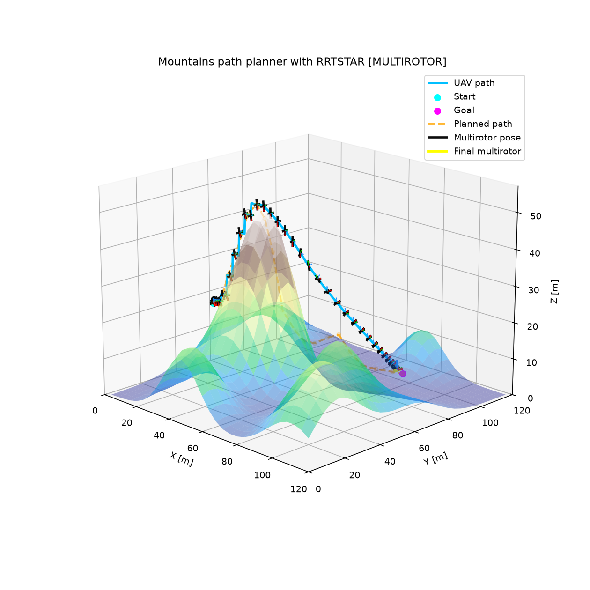
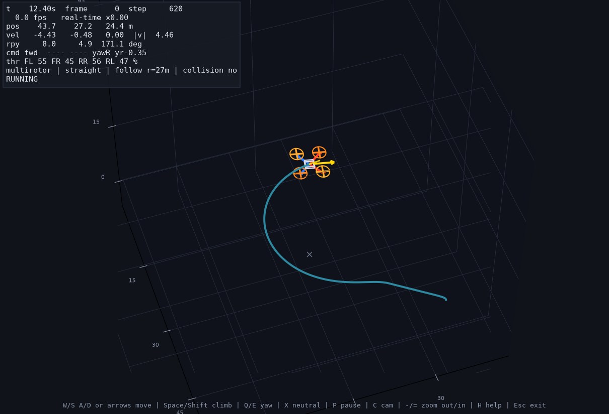
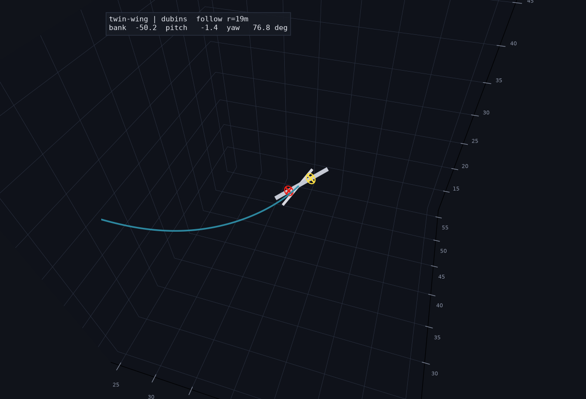
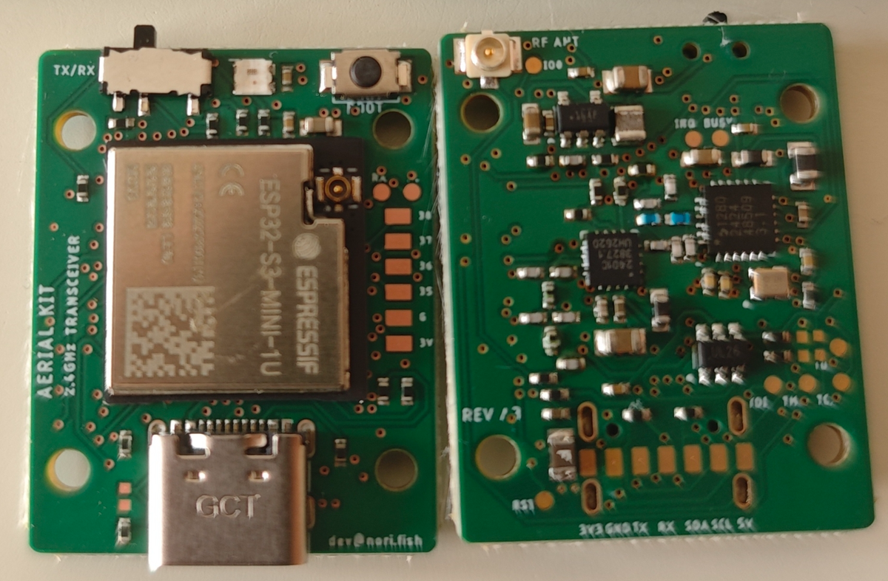
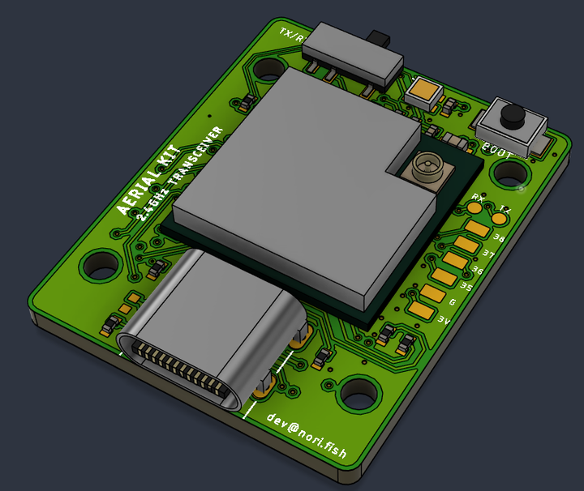
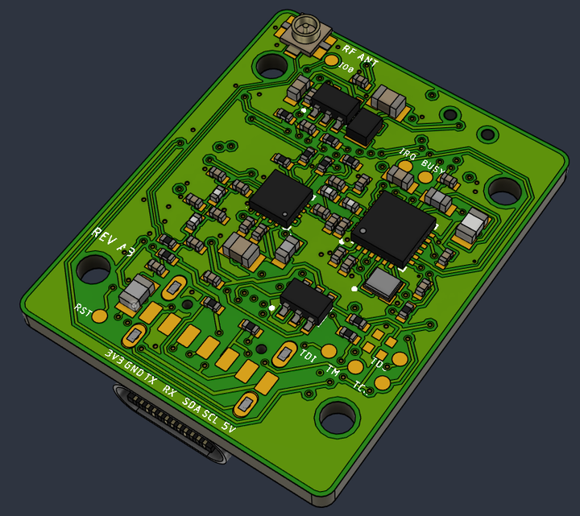
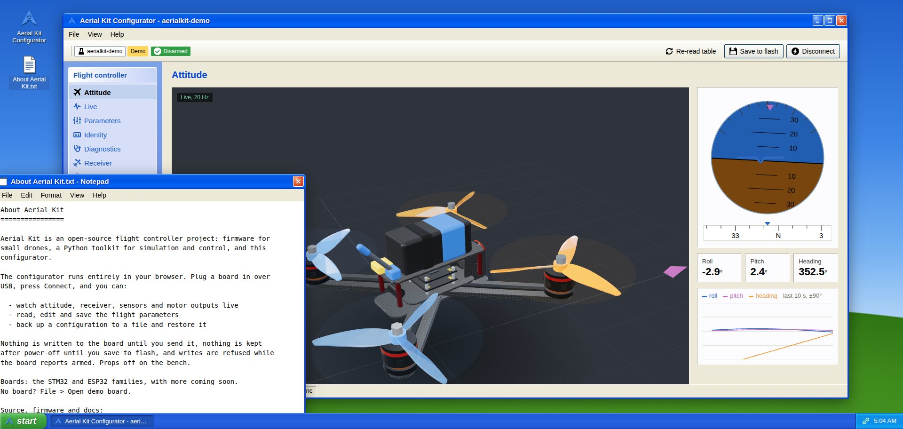
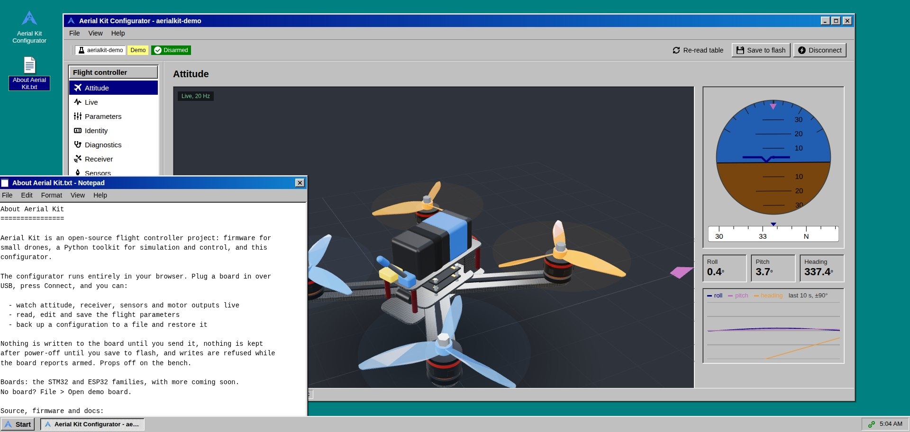

#  Aerial Kit

**UAS Controller, Planner, Simulator, Firmware & Configurator** - an open-source stack for aerial robots, from planning a path in simulation to configuring the flight controller.

## Demo

### Python simulation

Autonomous flight - plan a path, then fly it:

<table>
  <tr>
    <td width="50%" align="center"></td>
    <td width="50%" align="center"></td>
  </tr>
  <tr>
    <td valign="top"><em>RRT* through forest terrain on the RotorPy backend.</em></td>
    <td valign="top"><em>RRT* over mountains - the planner climbs a 47 m ridge to reach the goal. Planned path dashed in orange, flown trajectory in cyan.</em></td>
  </tr>
</table>

Standalone Python sim (Matplotlib 3D, follow camera):

<table>
  <tr>
    <td width="50%" align="center"></td>
    <td width="50%" align="center"></td>
  </tr>
  <tr>
    <td valign="top"><em>Native multirotor backend - a 56 m climbing turn, teal trail showing where it has flown. Each propeller is coloured by thrust (grey idle → yellow → orange → red).</em></td>
    <td valign="top"><em><a href="examples/fixed_wing">Twin-wing example</a> on the same renderer - banked 50° through the turn, flown path behind it, motors on the same colour map.</em></td>
  </tr>
</table>

### Custom 2.4 GHz LoRa / ELRS radio hardware

The Aerial Kit 2.4 GHz USB transceiver is a fabricated
**ESP32-S3-MINI-1U + SX1280 + RFX2401C** four-layer board. Its paired firmware
includes an RF-off hardware diagnostic plus separate ExpressLRS TX and RX
images, all built from a pinned upstream revision.

  

Fabricated Rev A3 boards: ESP32-S3 module and USB-C side, alongside the
SX1280/RFX2401C RF and control side.

<table>
  <tr>
    <td width="50%" align="center"></td>
    <td width="50%" align="center"></td>
  </tr>
  <tr>
    <td valign="top"><em>Rev A3 front: USB-C, ESP32-S3 module, role select, boot control and breakout pads.</em></td>
    <td valign="top"><em>Rev A3 back: SX1280 transceiver, RFX2401C front end, RF matching network and U.FL output.</em></td>
  </tr>
</table>

[Hardware sources and pinout](hardware/overlays/elrs-usb-tx/rev-a3/) ·
[Diagnostic, ExpressLRS TX and RX firmware](firmware/elrs-usb-tx-rev-a3/)

### Web configurator

[**Open the configurator**](https://rawfish69.github.io/aerial-kit/) · [Guide](docs/web-configurator.md)

Live attitude, receiver, sensors and parameter editing in the browser, over USB. Screenshots use the built-in demo board.

<table>
  <tr>
    <td width="50%"></td>
    <td width="50%"></td>
  </tr>
  <tr>
    <td><em>Classic theme.</em></td>
    <td><em>OG theme. A dark Modern theme is the default.</em></td>
  </tr>
</table>

### Hovering & Landing (IMU + Barometer + GPS)

https://github.com/user-attachments/assets/44837663-b281-45db-9803-5aaa9812833d

*Autonomous hover and landing, commanded over the CRSF/ESP-NOW link. The state estimate fuses IMU
attitude, barometric altitude, and GPS position.*

### ROS navigation

  

## What's in this repo

- **Controller** - standalone Python and ROS 2 control: PID, LQR, MPC, constrained MPC and MPPI, plus L1/TECS for fixed wing. The [`uav_control`](ros2_ws/src/uav_control/README.md) ROS 2 package flies missions with the constrained MPC or MPPI.
- **Planner** - straight, A*, RRT, RRT* and Dubins paths with shared terrain models.
- **Simulator** - Python simulation without ROS, plus ROS 2 fast, Gazebo and MuJoCo backends: FPV, micro long-range, research hex/octo multirotors and twin/single-motor flying wings, flyable autonomously or by keyboard.
- **AK Firmware** - our custom C flight controller, for Feather F405 and ESP32DEV, with a portable control core and image checks.
- **ELRS USB TX Rev A3** - custom ESP32-S3 + SX1280 + RFX2401C transceiver
  hardware and pinned ExpressLRS firmware target.
- **Web configurator** - live attitude, diagnostics and parameter editing over USB or a local bridge; includes a demo board.

The ROS-free control package is also on [PyPI](https://pypi.org/project/aerial-kit/): `pip install aerial-kit` or `pip install "aerial-kit[sim]"`.

## Autopilot & firmware support

| Platform | Integration | Guide |
| --- | --- | --- |
| **AK Firmware** | Custom flight-controller firmware + web configurator | [Guide](docs/flight-controller-firmware.md) |
| Betaflight | CRSF over ESP-NOW / UDP relay | [Guide](docs/HARDWARE.md) |
| PX4 | MAVLink over USB / UART / telemetry radio | [Guide](ros2_ws/src/mavlink_bridge/README.md) |
| ArduPilot | MAVLink through the same backend | [Guide](ros2_ws/src/mavlink_bridge/README.md) |
| ESP32 radio links | ESP-NOW, ELRS, LoRa and GPS | [Guide](firmware/legacy/README.md) |
| **Aerial Kit ELRS USB TX Rev A3** | Custom hardware, RF-off diagnostic, ELRS TX and RX images | [Guide](firmware/elrs-usb-tx-rev-a3/README.md) |

## Start here

| Explore | Guide |
| --- | --- |
| Run a simulator or controller | [Software guide](docs/SOFTWARE_GUIDE.md) · [Examples](docs/EXAMPLE_USAGE.md) |
| Build AK firmware | [Firmware quick start & board status](docs/flight-controller-firmware.md) |
| Configure a board | [Web configurator quick start](docs/web-configurator.md) · [Build & deployment](apps/configurator/docs/BUILD-AND-DEPLOY.md) |
| Connect Python to firmware | [USB telemetry and attitude example](examples/firmware/) |
| Hardware designs and overlays | [Hardware workspace](hardware/) |
| Understand the stack | [Architecture, airframes, ROS 2 and roadmap](docs/STACK-GUIDE.md) |
| Connect hardware | [Hardware guide](docs/HARDWARE.md) · [Radio firmware](firmware/legacy/README.md) |
| Use the logo | [Branding & SVG assets](docs/branding.md) |

## Licence

The Python/ROS stack and existing link projects retain the root [MIT licence](LICENSE). AK flight-controller firmware and the web configurator are **GPL-3.0-or-later**, each with its own [firmware](firmware/LICENSE) and [configurator](apps/configurator/LICENSE) licence. Third-party notices stay with their components.
