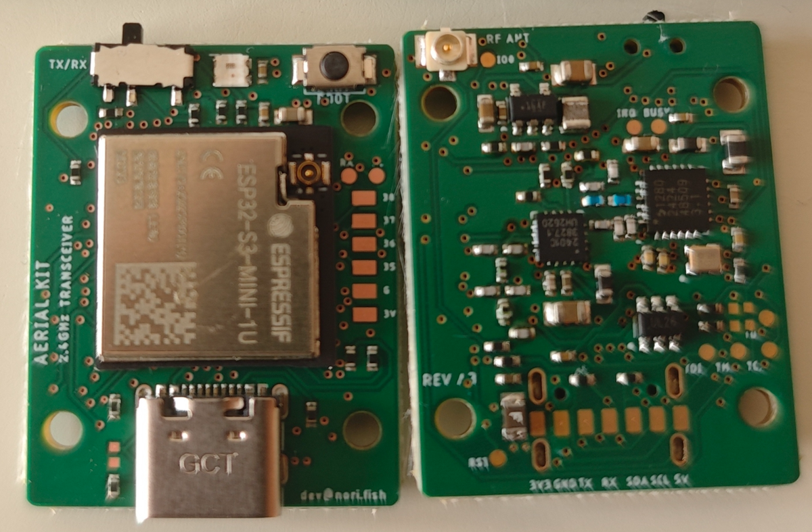

# Hardware

This directory holds editable Aerial Kit hardware sources and their
supporting documents; `assets/` continues to hold images and simulation
assets.

Current overlay:

- [ELRS USB TX Rev A3](overlays/elrs-usb-tx/rev-a3/) — ESP32-S3-MINI-1U,
  SX1280 and RFX2401C 2.4 GHz transceiver. The matching diagnostic and
  ExpressLRS builds are under
  [`firmware/elrs-usb-tx-rev-a3/`](../firmware/elrs-usb-tx-rev-a3/).

  

Feather F405 and ESP32DEV firmware profiles remain in
[`firmware/src/boards/`](../firmware/src/boards/).

## Overlays

Put future contributions under `overlays/<board>/<revision>/`. Each contribution should include:

- A README identifying the board, revision, purpose and supported firmware profile.
- Editable source files with a licence and attribution.
- Pin assignments, voltage levels, buses and conflicts with the stock board.
- Assembly/wiring instructions and an explicit distinction between tested hardware and proposed designs.
- Exported drawings or fabrication files alongside their source, with generation instructions.

The [overlays directory](overlays/README.md) is a placeholder. Adding files here does not automatically add firmware support.
